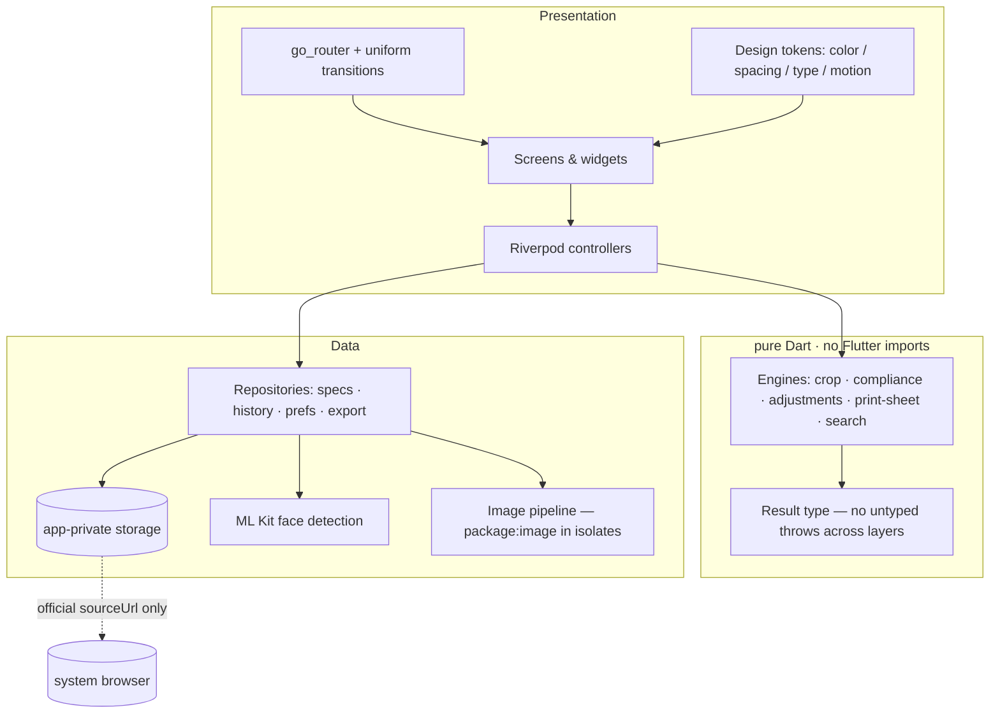

<div align="center">

# PhotoPass

**Offline passport, visa & ID photo maker**

Specification-compliant, print-ready document photographs — produced entirely
on-device, with no account, no ads, no subscriptions, and no upload.


</div>

---

## Table of contents

1. [Overview](#1-overview)
2. [Product principles](#2-product-principles)
3. [Capabilities](#3-capabilities)
4. [Data integrity & spec provenance](#4-data-integrity--spec-provenance)
5. [Privacy & security architecture](#5-privacy--security-architecture)
6. [System architecture](#6-system-architecture)
7. [Design system](#7-design-system)
8. [Accessibility & internationalization](#8-accessibility--internationalization)
9. [Performance engineering](#9-performance-engineering)
10. [Quality engineering](#10-quality-engineering)
11. [Getting started](#11-getting-started)
12. [Build & release](#12-build--release)
13. [Repository layout](#13-repository-layout)
14. [Extending the platform](#14-extending-the-platform)
15. [Documentation index](#15-documentation-index)
16. [Known limitations](#16-known-limitations)
17. [License](#17-license)

---

## 1. Overview

PhotoPass turns a phone camera into a compliant document-photo studio. A user
picks a document (a country's passport or visa specification), captures or
imports a photo against a live face guide derived from that specification,
adjusts it in a guided editor, reviews an honest compliance checklist, and
exports an exact-size photo, a true-size PDF, and print sheets — all without
the photo ever leaving the device.

| Aspect | Detail |
| --- | --- |
| Version | 1.0.0+1 (`pubspec.yaml`), private package (`publish_to: none`) |
| Platforms | Android (primary, Play-Store-ready configuration); web (UI preview) |
| Framework | Flutter stable 3.47.7 · Dart SDK ^3.13.5 · Material 3 |
| State management | Riverpod 3 with strict rebuild discipline |
| Shipping surface | 10 screens, 8 verified document presets, 15 languages |

**Who it is for.** Anyone who needs a compliant passport, visa or ID photo and
does not want to hand their biometric image to an online service: travelers,
expatriates, visa applicants, and privacy-conscious households.

## 2. Product principles

These are non-negotiable commitments, enforced in code and audited in tests
(`test/privacy_audit_test.dart` fails the build if they are violated):

| # | Commitment | Enforcement |
| --- | --- | --- |
| 1 | **Free forever** — no ads, subscriptions, in-app purchases, paywalls, watermarks, or feature tiers | Privacy audit test; no payment/tracking SDKs in `pubspec.yaml` |
| 2 | **Privacy first** — photos, crops and history never leave the device | On-device storage only; no upload paths exist in the codebase |
| 3 | **No fabricated data** — every specification carries an official `sourceUrl` and `lastVerified` date | Asset validation test (`photo_specs_asset_test.dart`) |
| 4 | **Honest results** — the checklist advises and never claims official approval; exports report real measured output | Compliance engine returns measured values only; export success comes only from the pipeline |
| 5 | **Fully accessible & offline** — complete functionality without connectivity; usable at 1.5× text scaling, in RTL, with a screen reader | Dedicated test suites (see [§10](#10-quality-engineering)) |

## 3. Capabilities

| Domain | Capabilities |
| --- | --- |
| **Specification catalog** | Searchable, country-grouped presets (passports & visas) with size, DPI, background colour, head-height range, eye-line range, glasses rule, gender rules where applicable, verification badge, official source link |
| **Capture** | Full-screen camera with spec-driven face guide overlay; flash control (auto/on/off); front/back switch; gallery import as a camera-free path; graceful no-permission flow |
| **Face analysis** | On-device ML Kit face detection mapped to a normalized face domain (head bounds, eye line) — no cloud calls |
| **Editor** | Face-guided auto-crop; pinch/zoom crop locked to the exact aspect ratio; 90° rotation; brightness/contrast/saturation; on-device background replacement with required/suggested colour palettes; live processed preview; discard-confirmation on unsaved edits |
| **Compliance checklist** | Per-requirement status (size, head height, eye line, background uniformity, glasses, file size) with measured values, plain-language explanations, and actionable next steps |
| **Export** | Pixel-exact photo at required DPI; print-ready PDF at true physical size; 4×6 in / 10×15 cm print sheets; save to gallery or system share; collapsible technical details |
| **History** | Local record of saved photos with reopen-in-editor, share, delete, and graceful handling of missing files |
| **Personalization** | Favourites & recents on home and in the picker; light/system/dark theme; app language override; clear-data & clear-history privacy controls |
| **Onboarding** | 3-page first-run flow (privacy promise, how it works, language), shown once and persisted |

## 4. Data integrity & spec provenance

Government specifications change over time; a stale number silently produces a
reusable-but-noncompliant photo. PhotoPass treats specification data as
**sourced, dated, and auditable**:

- Every preset stores an **`sourceUrl`** pointing to the official issuing
  authority's published guidance and a **`lastVerified`** ISO date.
- The UI displays the verification state to the user; presets are never
  presented as authoritative beyond their verification date.
- `photo_specs_asset_test.dart` **fails the build** if any preset lacks a
  source URL or verification date — invented data cannot ship.
- Specs are plain JSON assets (`assets/presets/`): adding or updating a
  country is a data change with a reviewable diff, not a code change.

The compliance checklist is **guidance, not certification**. It measures what a
phone can measure (geometry, colour uniformity, file size, detected-face
rules) and says so; authorities may apply judgment the app cannot — this is
stated in-app and in the store listing.

## 5. Privacy & security architecture

```
                    ┌────────────────────────────────────────┐
                    │              PhotoPass                  │
  Camera ──────────▶│  capture ─▶ editor ─▶ export            │
  Gallery ─────────▶│     │         │         │              │
                    │     ▼         ▼         ▼              │
                    │   on-device processing (isolates)       │
                    │     │                    │              │
                    │     ▼                    ▼              │
                    │  app-private storage   share sheet ───────▶  OS only
                    │  (photos, history)     (explicit user action)
                    └────────────────────────────────────────┘
                                 ▲
                                 │ opens official sourceUrl
                                 └──▶ system browser (url_launcher)
```

- **No tracking, analytics, advertising, crash-beacon or payment SDKs** exist
  in the dependency tree; `privacy_audit_test.dart` enforces this.
- **No upload path exists.** The only outbound action in the entire app is
  opening a specification's official `sourceUrl` in the system browser via
  `url_launcher` — a user-initiated, per-link action.
- **Storage is app-private** (photos, processed exports, history JSON,
  preferences). Deleting data in Settings deletes it; history entries are
  individually deletable.
- **Camera permission is optional**: the gallery-import path works without
  it, and the app degrades gracefully when permission is denied.
- Full policy and audit: [`docs/privacy_policy.md`](docs/privacy_policy.md),
  [`docs/privacy_audit.md`](docs/privacy_audit.md).

## 6. System architecture

Feature-first clean architecture: each feature owns `domain` (pure Dart
models/rules), `data` (repositories, platform channels, providers), and
`presentation` (widgets/controllers). The domain layer has **zero Flutter
imports**, so every rule is unit-testable with plain Dart.



| Concern | Decision |
| --- | --- |
| State | Riverpod 3 — narrow, derived providers; screens subscribe to view-models, not raw state; rebuild discipline is budget-tested |
| Navigation | `go_router` declarative routes; one shared page transition; unsaved-work guards via `PopScope` |
| Errors | A `Result` type carries success/failure across layers; no silent catch-and-fake; failures surface as actionable UI states |
| Concurrency | Heavy image work (crop, rotate, retouch, encode, PDF) runs in background isolates (`compute`), keeping the UI at frame rate |
| Persistence | `shared_preferences` for settings/favourites/recents; JSON file store for history; all wrapped behind repositories so the UI never touches files or channels |

## 7. Design system

A single token layer (`lib/app/theme/`) is the only source of visual
constants; screens contain no hard-coded colours or magic spacing.

| Token group | Values |
| --- | --- |
| Accent (light / dark) | `#2457D6` / `#8EACFF` |
| Spacing scale | 4 pt base grid (4/8/12/16/20/24/32…) |
| Corner radii | 8 / 12 / 16 / 20 |
| Typography | Material 3 text theme, theme-aware, scaling-safe |
| Motion | One uniform screen transition; **reduce-motion respected** — transitions and in-page animation are disabled when the OS requests it |
| Themes | Light, dark and system, derived from the same tokens |

Layouts are verified at **1.5× text scaling on a small viewport** (320 pt
logical width) with zero overflow, and the editor adapts from stacked to
rail layout in landscape.

## 8. Accessibility & internationalization

**Accessibility practices** (asserted in `rtl_accessibility_test.dart`):

- All icon-only controls carry tooltips and semantic labels.
- Primary action buttons meet the 48 dp touch-target minimum.
- Navigation destinations expose localized semantics to screen readers.
- Dynamic Type / font scaling is respected app-wide with no clipping.
- Color is never the sole carrier of status (icons + text accompany it).

**Internationalization** — 15 languages, full RTL support:

| Direction | Languages |
| --- | --- |
| LTR | English, Bengali, Chinese (Simplified), French, German, Hindi, Indonesian, Japanese, Portuguese, Russian, Spanish, Turkish |
| RTL | Arabic, Persian, Urdu |

- Every user-facing string flows through `gen_l10n` ARB files; no literals in
  widgets.
- RTL flips interface chrome only — **the captured photo is never mirrored**.
- `localization_coverage_test.dart` enforces, across all 15 locales: key
  parity (165 keys each), placeholder consistency, and protection against
  untranslated-copy regressions. `flutter gen-l10n` reports zero untranslated
  messages.

## 9. Performance engineering

| Concern | Approach |
| --- | --- |
| Frame budget | No image processing on the UI thread; all pixel work (`package:image`) runs in isolates via `compute` |
| Rebuild discipline | Screens consume derived view-model providers; perf budgets in `perf_budget_test.dart` fail on excessive rebuilds |
| Memory lifecycle | Decoded images are released when the editor closes (`releaseImages()`); reload restores session state (crop, face, retouch) without rebinding large buffers |
| Startup | Cold start shows themed splash → persisted onboarding/settings resolution → home; preferences are the only awaited I/O |
| Widgets | Lazy lists for history/specs; const constructors throughout; no per-frame allocations in overlays |

## 10. Quality engineering

Current gate results (see [`docs/part3_acceptance.md`](docs/part3_acceptance.md)
for the full record):

| Gate | Command | Result |
| --- | --- | --- |
| Static analysis | `flutter analyze` | **0 issues** (flutter_lints 6 + strict config) |
| Test suite | `flutter test` | **249 / 249 passing** |
| Golden snapshots | included in suite | 4/4 (home light/dark/RTL, settings) |
| Localization parity | included in suite | 15/15 locales |
| Privacy audit | included in suite | clean — no tracking/ads/payments/data-sale code |
| Text scaling | included in suite | 1.5× on small viewport, LTR + RTL |

Test portfolio (18 suites):

| Suite | Scope |
| --- | --- |
| `photo_spec_test` · `photo_specs_asset_test` · `spec_search_test` | Spec model, asset provenance rules, search |
| `crop_engine_test` · `face_guide_test` | Crop suggestion math, face-guide geometry |
| `compliance_engine_test` | Per-rule measurement & status logic |
| `photo_adjustments_test` · `print_sheet_test` | Adjustment math, print-sheet/PDF layout |
| `app_test` · `capture_screen_test` · `editor_flow_test` | End-to-end widget flows incl. the full capture→editor→compliance path |
| `persistence_test` | Settings, theme, language, favourites, recents across restarts |
| `text_scaling_test` | 1.5× scale, small viewport, LTR + RTL |
| `rtl_accessibility_test` | RTL direction, semantics, tooltips, touch targets |
| `localization_coverage_test` | 15-locale parity gate |
| `perf_budget_test` | Rebuild/performance budgets |
| `privacy_audit_test` | Free-forever & privacy enforcement |
| `goldens/goldens_test` | Golden snapshots (light, dark, RTL) |

Device end-to-end tests live in `integration_test/` and run on hardware/CI —
no emulator dependency is required by the unit/widget gate.

## 11. Getting started

**Prerequisites:** Flutter stable **3.47.7** (Dart **3.13.5**), Android SDK
for device builds.

```bash
flutter pub get            # resolve dependencies
flutter gen-l10n           # generate localizations (also runs via `flutter run`)
flutter run                # run on a connected device or emulator
```

**Web UI preview** (browse, settings, onboarding — camera and ML Kit are
mobile-only):

```bash
flutter run -d web-server --web-port 8080 --web-hostname localhost
```

**Verify the gates:**

```bash
flutter analyze            # must report 0 issues
flutter test               # must report 249/249
```

## 12. Build & release

```bash
# App icons (source art in assets/icon/)
dart run tool/generate_icon.dart
dart run flutter_launcher_icons

# Release artifact
flutter build apk --release
```

- Versioning follows the `pubspec.yaml` `version: X.Y.Z+N` scheme
  (semantic version + build number).
- The release checklist used for the Play Store draft lives in
  [`docs/store_listing.md`](docs/store_listing.md); product commitments that
  may never change are in
  [`docs/product_policy.md`](docs/product_policy.md).

## 13. Repository layout

```
lib/
├── app/
│   ├── theme/          # design tokens: colour, spacing, typography, motion
│   ├── flow/           # selected spec, onboarding, favourites, recents state
│   ├── router/         # go_router routes + uniform, motion-safe transitions
│   └── shell/          # bottom navigation shell
├── core/               # Result type, prefs wrapper, shared widgets, constants
├── features/
│   ├── onboarding/     # 3-page first-run flow
│   ├── country_select/ # spec database, search, favourites, home
│   ├── capture/        # camera, permissions, face guide overlay
│   ├── face_detection/ # ML Kit service + normalized face domain
│   ├── editor/         # crop engine, image pipeline, retouch, mode UI
│   ├── compliance/     # compliance engine + checklist UI
│   ├── export/         # exact-size export, PDF, print sheets
│   ├── history/        # local file-backed history
│   └── settings/       # theme, language, privacy controls, about
└── l10n/               # ARB files (15 locales) + generated localizations
test/                   # 18 suites — see §10
integration_test/       # device end-to-end flows (hardware/CI)
docs/                   # policies, audits, store listing, acceptance record
assets/presets/         # sourced specification data (sourceUrl + lastVerified)
tool/                   # icon generation script
```

## 14. Extending the platform

**Add a document specification** — a data change in `assets/presets/`:

1. Create/edit the preset JSON: size (px + DPI), background colour, head
   height & eye-line ranges, glasses/gender rules as applicable.
2. **Mandatory:** an `sourceUrl` (official authority page) and `lastVerified`
   date. The asset test rejects entries without them — never invent either.
3. Run `flutter test test/photo_specs_asset_test.dart`.

**Add a language:**

1. Add `lib/l10n/app_<code>.arb` translated by a competent speaker (machine
   copying of English is blocked by the parity gate's copy-protection rules).
2. Register it in `l10n.yaml`; run `flutter gen-l10n`.
3. Run `flutter test test/localization_coverage_test.dart` — it enforces key
   parity (165 keys), placeholder consistency and RTL correctness where
   applicable.

**Add a feature module** — follow the feature-first layout: `domain` (pure
Dart) → `data` (repositories/providers) → `presentation` (widgets +
Riverpod controllers); wire routes in `lib/app/router/`.

## 15. Documentation index

| Document | Contents |
| --- | --- |
| [`docs/product_policy.md`](docs/product_policy.md) | Free-forever commitments (no ads, subscriptions, paywalls, watermarks) |
| [`docs/privacy_policy.md`](docs/privacy_policy.md) | Full privacy policy |
| [`docs/privacy_audit.md`](docs/privacy_audit.md) | Privacy audit results and enforcement points |
| [`docs/store_listing.md`](docs/store_listing.md) | Play Store listing draft + release checklist |
| [`docs/part3_acceptance.md`](docs/part3_acceptance.md) | §32–§42 acceptance gate record with measured results |

## 16. Known limitations

Stated plainly, as the product states them to users:

1. **The checklist is guidance, not certification.** Authorities may apply
   rules a phone cannot verify (expression, subtle background issues). The
   official source link is always shown for confirmation.
2. **Web build is a UI preview.** Camera capture, ML Kit face detection and
   `dart:io`-based history/export are mobile-only.
3. **Golden snapshots are machine-specific** (text rasterization differs per
   platform); regenerate with `flutter test --update-goldens` on new
   hardware.
4. **Widget tests override the image pipeline** with a main-isolate fake —
   Dart isolates do not resume under the fake-async test environment. The
   production isolate path is exercised on hardware via `integration_test/`.
5. **Android-first.** The configuration is Play-Store-ready; iOS project
   scaffolding exists but has not been through App Store review tooling.

---

## 17. License

PhotoPass is released under the [MIT License](LICENSE).

```
Copyright (c) 2026 HAMZA POWERPLAYER
```

You are free to use, copy, modify, merge, publish, distribute, sublicense and
sell copies of the software, subject to the conditions in [`LICENSE`](LICENSE).
This does not change the product commitments in
[`docs/product_policy.md`](docs/product_policy.md) — the app itself remains
free of ads, subscriptions, paywalls and watermarks.

---

<div align="center">

**PhotoPass** — your document photo never leaves your phone.

Free forever, offline by design. See [`docs/product_policy.md`](docs/product_policy.md).

</div>
